# PAVEMENT-PINN

**Potret jalan rusak. AI dan petugas menanganinya sampai tuntas.**

Warga memotret kerusakan jalan dari 3 sisi. AI di atas **Intel® OpenVINO™** mengenali jenisnya (lubang, retak,
alur roda, amblas, tambalan, genangan, dan lainnya). Petugas lapangan memeriksa di lokasi dengan **inspeksi
terpandu**: foto dari beberapa sisi, ukuran diambil langsung di foto dengan skala pembanding. **PINN** (Physics-Informed
Neural Network) menghitung respons struktur jalan, sisa umur, dampak truk kelebihan muatan, dan **cuaca nyata**
(curah hujan Open-Meteo). Koordinator instansi memutuskan penanganan dan menerbitkan SPK, lalu warga melihat dan
mengonfirmasi hasil perbaikannya. Setiap keputusan manusia wajib beralasan dan tercatat.

> Intel AI Global Impact Festival 2026 · Stage 3

**Aplikasi live:** https://avlfelo.tail8b73d2.ts.net · halaman transparansi AI: https://avlfelo.tail8b73d2.ts.net/bukti/

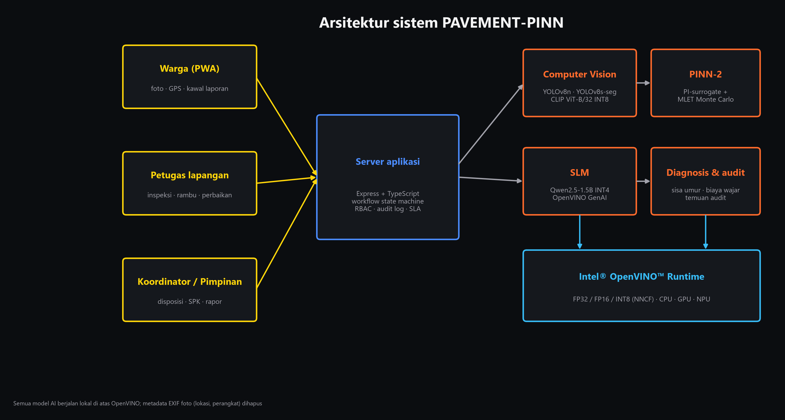

---

## Daftar isi

1. [Akun demo](#1-akun-demo)
2. [Perjalanan pengguna (dengan screenshot)](#2-perjalanan-pengguna)
3. [Fitur per peran](#3-fitur-per-peran)
4. [Mesin AI dan angka terukur](#4-mesin-ai-dan-angka-terukur)
5. [Cuaca: Open-Meteo masuk ke PINN](#5-cuaca-open-meteo-masuk-ke-pinn)
6. [Perangkat Intel: CPU, GPU, NPU](#6-perangkat-intel-cpu-gpu-npu)
7. [Menjalankan aplikasi](#7-menjalankan-aplikasi)
8. [Pengujian](#8-pengujian)
9. [Bahan pitch deck (slide, video, grafik)](#9-bahan-pitch-deck)
10. [Struktur repo](#10-struktur-repo)
11. [Privasi, keamanan, dan tata kelola](#11-privasi-keamanan-dan-tata-kelola)

---

## 1. Akun demo

**Warga tidak perlu login.** Cukup buka aplikasinya; akun perangkat dibuat otomatis (bisa juga daftar dengan email).

### Akun umum (tanpa wilayah dinas khusus)

| Peran | Email | Password |
|---|---|---|
| Koordinator | koordinator@pavement-pinn.id | Koor-c31be7 |
| Petugas Lapangan | petugas@pavement-pinn.id | Petugas-13c308 |

### Akun per dinas (wilayah pilot DKI Jakarta + Karawang)

| Instansi | Peran | Email | Password |
|---|---|---|---|
| BBPJN Jawa Barat – DKI Jakarta (jalan nasional) | Koordinator | koordinator.bbpjn-jabar-dki@pavement-pinn.id | Pinn-f43c5fa3 |
| | Pengawas Lapangan | pengawas.bbpjn-jabar-dki@pavement-pinn.id | Pinn-289e1dcf |
| Dinas Bina Marga Prov. DKI Jakarta | Koordinator | koordinator.dbm-dki@pavement-pinn.id | Pinn-fea8726f |
| | Pengawas Lapangan | pengawas.dbm-dki@pavement-pinn.id | Pinn-87bc2006 |
| Sudin Bina Marga Jakarta Timur | Koordinator | koordinator.sudin-bm-jaktim@pavement-pinn.id | Pinn-bf4c843f |
| | Pengawas Lapangan | pengawas.sudin-bm-jaktim@pavement-pinn.id | Pinn-aa1d5989 |
| Dinas BMPR Prov. Jawa Barat | Koordinator | koordinator.dbmpr-jabar@pavement-pinn.id | Pinn-a10cbc35 |
| | Pengawas Lapangan | pengawas.dbmpr-jabar@pavement-pinn.id | Pinn-8d50434b |
| Dinas PUPR Kab. Karawang | Koordinator | koordinator.dpupr-karawang@pavement-pinn.id | Pinn-9ff44202 |
| | Pengawas Lapangan | pengawas.dpupr-karawang@pavement-pinn.id | Pinn-27f190c9 |

Akun **Pimpinan Instansi** (`pimpinan.<instansi>@pavement-pinn.id`) dibuat oleh `scripts/seed-agencies.ts`; sandinya
dicetak sekali saat skrip dijalankan.

> Repo ini publik: siapa pun dengan password di atas bisa masuk ke situs live. Ganti password setelah kompetisi
> (`npm run create-coordinator`, atau menu **Tim → Nonaktifkan** untuk petugas).

---

## 2. Perjalanan pengguna

Dua simulasi lengkap dijalankan **di aplikasi asli** (UI, AI, server, dan Open-Meteo sungguhan) di salinan data
terpisah, dan setiap langkah di-screenshot. Slide siap pakai ada di
[`pitchdeck-visuals/slides/`](pitchdeck-visuals/slides/) dan rekaman layar di
[`pitchdeck-visuals/videos/`](pitchdeck-visuals/videos/).

| # | Peran | Langkah | Simulasi 1 (lubang, Karawang) |
|---|---|---|---|
| 1 | Warga | Buka peta "Sekitar Anda" | 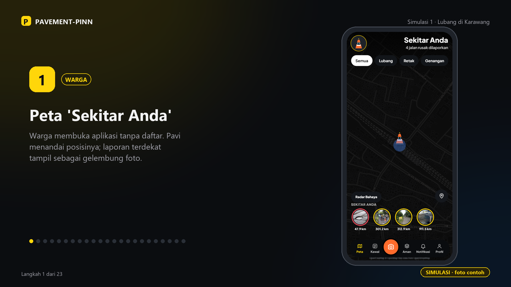 |
| 2 | Warga | Kamera dengan AI langsung, lalu foto | 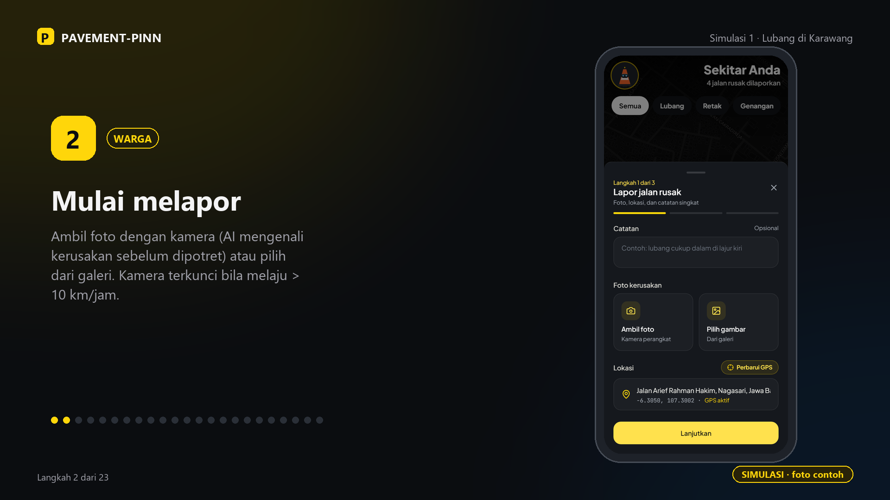 |
| 3 | AI | Pavi menganalisis, hasil dalam detik |  |
| 4 | Warga | Tambah foto 2 sisi lain, kirim |  |
| 5 | Koordinator | Pusat Kendali: alur 8 langkah + peta kasus |  |
| 6 | Petugas | Inspeksi terpandu 3 sisi + AI per foto |  |
| 7 | Petugas | Ukur panjang, lebar, kedalaman di foto |  |
| 8 | Koordinator | Ringkasan kasus + cuaca 7 hari |  |
| 9 | Petugas | Struktur perkerasan + analisis PINN |  |
| 10 | Koordinator | Setujui rekomendasi, terbitkan SPK | 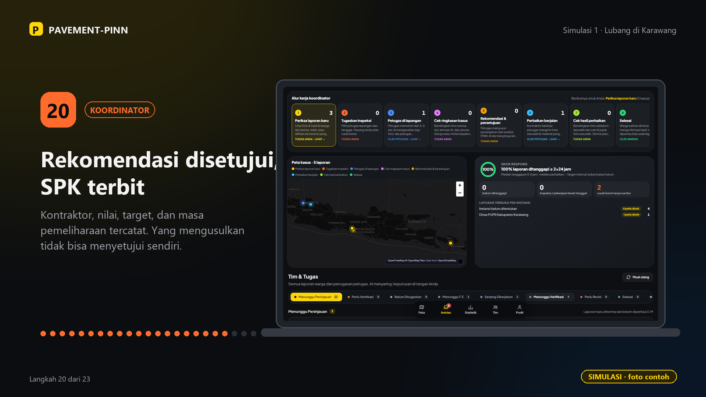 |
| 11 | Koordinator | Verifikasi foto sebelum–sesudah + cek AI | 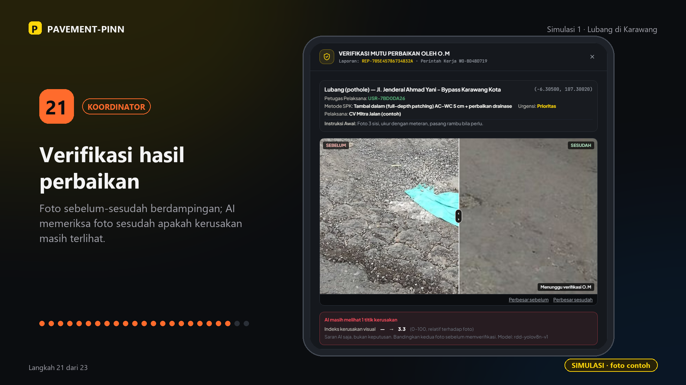 |
| 12 | Warga | Status selesai sampai ke pelapor |  |

Status kasus di server pada simulasi: `NEEDS_REVIEW → VERIFIED → FIELD_INSPECTION_REQUESTED → INSPECTED →
INSPECTION_VERIFIED → ACTION_RECOMMENDED → ACTION_APPROVED → IN_PROGRESS → RESOLVED`.

Simulasi memakai foto contoh dari repo (`public/photos/`); foto 3 sisi pada simulasi adalah potongan dari satu foto.
Jalankan ulang dengan foto Anda sendiri lewat `.e2e-tmp/journey.mjs` (lihat [§9](#9-bahan-pitch-deck)).

### Simulasi 2 (retak & tambalan, Jakarta Timur)

| Laporan 3 sisi | Inspeksi terpandu | Ringkasan kasus + cuaca | Hasil PINN | Selesai |
|---|---|---|---|---|
| 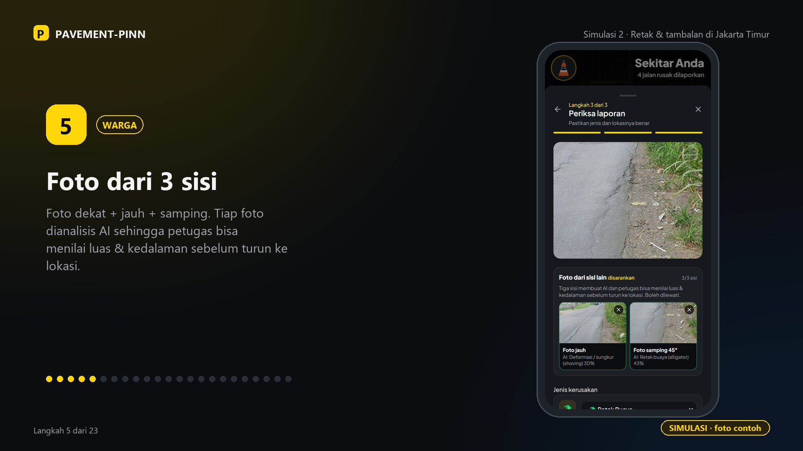 | 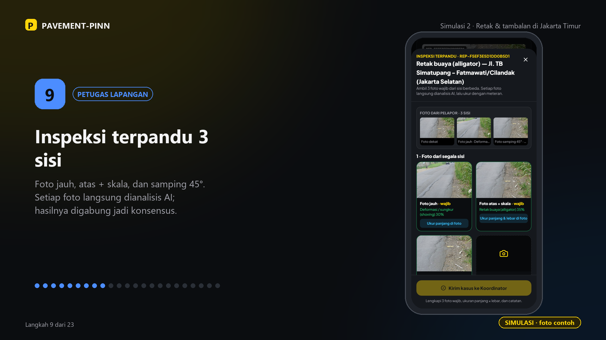 | 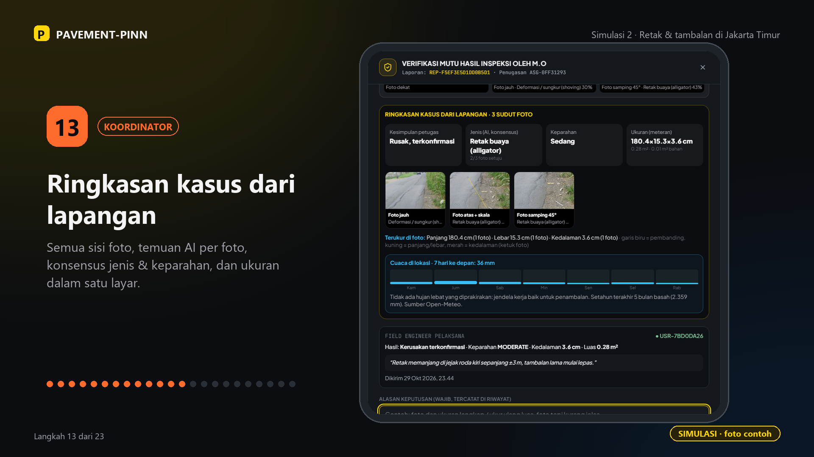 | 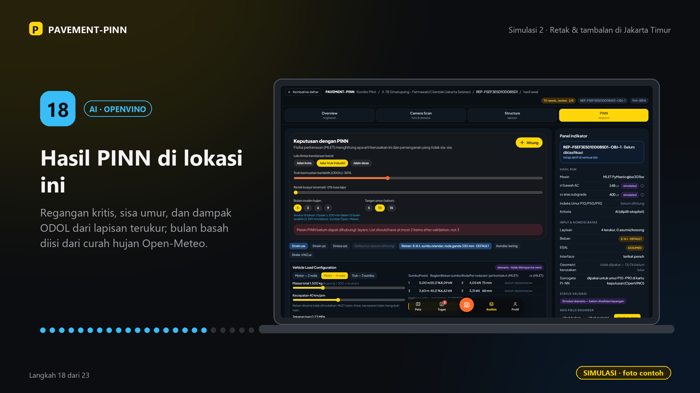 | 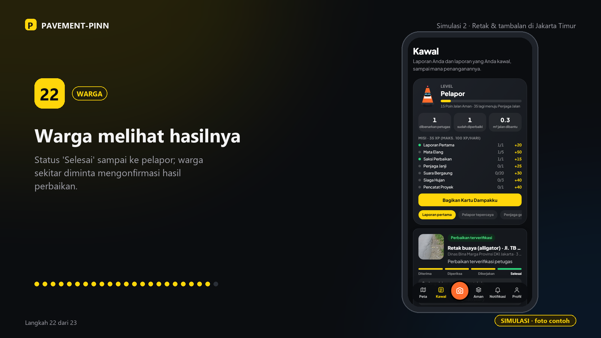 |

### Video (MP4, siap PowerPoint)

| Video | Isi |
|---|---|
| [simulasi_A_warga-melapor.mp4](pitchdeck-visuals/videos/simulasi_A_warga-melapor.mp4) | rekaman layar: warga melapor dengan foto 3 sisi |
| [simulasi_A_petugas-inspeksi.mp4](pitchdeck-visuals/videos/simulasi_A_petugas-inspeksi.mp4) | rekaman layar: inspeksi terpandu + ukur di foto |
| [deteksi_jalan-berlubang.mp4](pitchdeck-visuals/videos/deteksi_jalan-berlubang.mp4) | proses deteksi AI (pindai, kotak, label, hasil) |
| [training_pinn.mp4](pitchdeck-visuals/videos/training_pinn.mp4) | animasi kurva loss dari run training asli |

Pitch deck lengkap (latar belakang → dampak → solusi → teknologi Intel → data & model → hasil → demo → AI bertanggung jawab → rencana):
[`pitchdeck-visuals/PAVEMENT-PINN_pitchdeck_final.pptx`](pitchdeck-visuals/PAVEMENT-PINN_pitchdeck_final.pptx). Kotak logo Intel & festival di setiap slide adalah tempat menempel logo resmi.

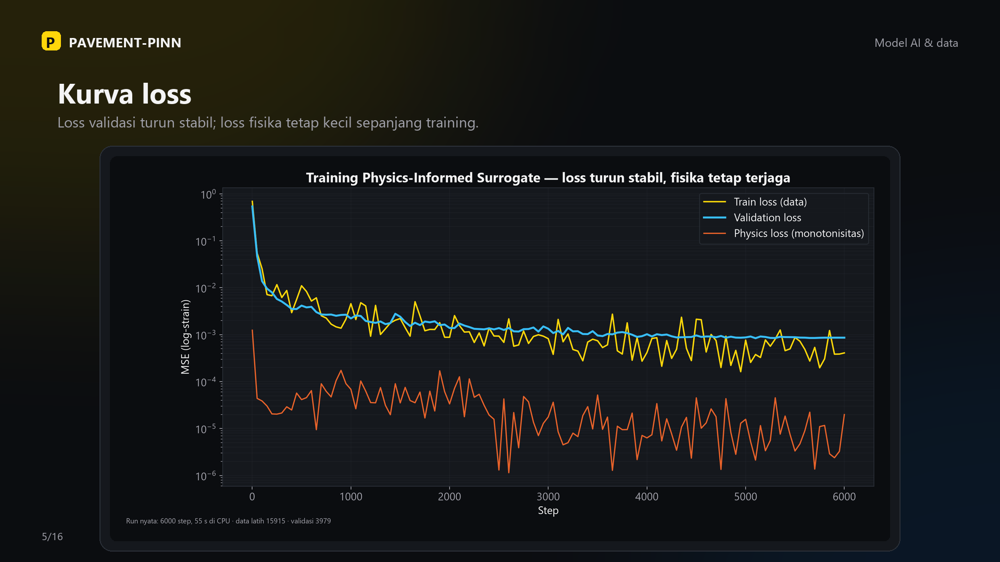
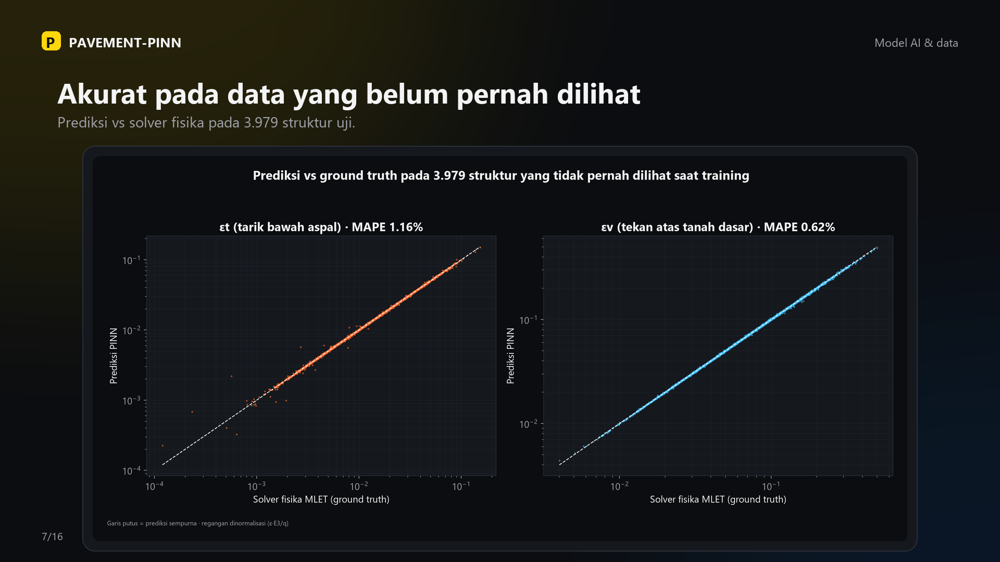
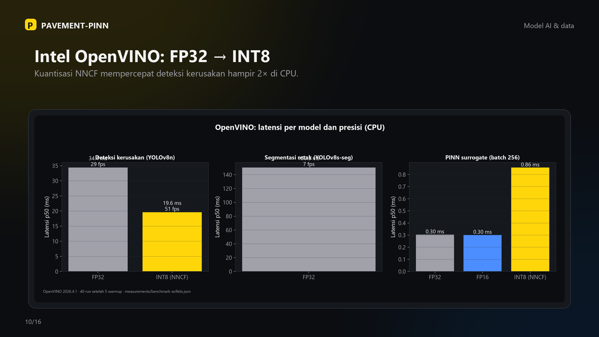

---

## 3. Fitur per peran

### Warga
- **Lapor dari lokasi**: GPS wajib segar, kamera terkunci di atas 10 km/jam, foto format apa pun (HEIC, AVIF, PNG, JPEG) dikonversi otomatis.
- **AI langsung di kamera** dan **Pavi menganalisis**: tahap AI tampil sesuai urutan nyata di server.
- **Foto 3 sisi** (dekat, jauh, samping), masing-masing dianalisis AI; bisa dilewati.
- **Lapor Offline**: tanpa sinyal, laporan disimpan di HP dan terkirim otomatis saat sinyal kembali.
- **Kawal**: status, jam pasir tenggat, eskalasi H+2/7/14/30, dukung laporan warga lain, konfirmasi hasil perbaikan.
- **Aman**: *Rute Aman* (alternatif rute dibandingkan bahaya terverifikasi), *Pantau Area Saya*, *Radar Bahaya* saat berkendara.
- **Profil**: avatar Pavi, poin dan level dari laporan yang dibenarkan petugas, **sertifikat PDF** dengan QR verifikasi, kartu dampak untuk dibagikan.

### Petugas Lapangan / Pengawas
- **Alur kerja petugas** 5 langkah dengan tombol utama sesuai status kasus.
- **Inspeksi terpandu**: 3 foto wajib (jauh, atas + skala, samping 45°) + 2 opsional; AI per foto, konsensus jenis dan keparahan.
- **Ukur di foto**: ketuk benda pembanding (meteran/A4/KTP) lalu ujung kerusakan, untuk panjang, lebar, dan kedalaman; kedalaman dari beberapa foto dirata-rata, dengan peringatan bila selisihnya > 20 %.
- **Rambu sementara** (UU 22/2009 Ps. 24 ayat 2), **Analisis PINN** (struktur, sisa umur, ODOL, musim hujan dari Open-Meteo), **rekomendasi penanganan**, **bukti perbaikan** (material, tebal, alat pemadat; AI memeriksa foto sesudah).

### Koordinator
- **Pusat Kendali**: alur kerja 8 langkah yang bisa diklik, peta kasus berwarna per langkah, skor respons, dan laporan per instansi.
- **Ringkasan kasus dari lapangan**: semua sisi foto + AI per foto + ukuran + garis ukur + cuaca 7 hari.
- Terima, tolak, atau **alihkan instansi**; tugaskan inspeksi; setujui rekomendasi (pengusul tidak bisa menyetujui sendiri); **SPK** (kontraktor, nilai, target, masa pemeliharaan); verifikasi perbaikan atau minta ulang; **Tim** (akun petugas); **Statistik** (dampak, kualitas AI, kalkulator kewajaran biaya, temuan audit).

### Pimpinan Instansi
- **Eskalasi** laporan yang melewati tenggat dan **Rapor Instansi** (kinerja respons per instansi).

---

## 4. Mesin AI dan angka terukur

| Mesin | Teknologi | Hasil terukur |
|---|---|---|
| Deteksi kerusakan | YOLOv8n (RDD) · OpenVINO FP32 / INT8 (NNCF) | 34,4 ms → **19,6 ms** (51 fps) di CPU dengan INT8 |
| Segmentasi retak | YOLOv8s-seg · OpenVINO | 150 ms/foto di CPU |
| Pemahaman scene | CLIP ViT-B/32 INT8 · OpenVINO, zero-shot 11 jenis + genangan + bukan-jalan | dipakai bila detektor tidak menemukan kotak; petugas memastikan |
| PINN-2 surrogate | MLP physics-informed, 19.894 solusi MLET (PyMastic) · OpenVINO | MAPE εt **0,67 %**, εv **0,49 %** vs solver; ±**2.100×** lebih cepat |
| Training ulang (visual) | sama, dijalankan ulang di laptop tim | MAPE εt 1,16 % · εv 0,62 % · pelanggaran fisika 0,25 % (MLP biasa 0,64 %) |
| SLM draf usulan | Qwen2.5-1.5B-Instruct INT4 · OpenVINO GenAI | angka diisi dari mesin, bukan dikarang model |
| Cuaca | Open-Meteo (ERA5 + prakiraan) | bulan basah otomatis untuk PINN |

Sumber angka: `measurements/*.json`, ditampilkan langsung di `/bukti`. Grafik: `pitchdeck-visuals/01…18_*.png`.

---

## 5. Cuaca: Open-Meteo masuk ke PINN

- `GET /api/weather?at=lat,lng` (server/services/weather.ts) mengambil **curah hujan 12 bulan terakhir** (arsip ERA5) dan **prakiraan 7 hari**, dengan cache per sel ±11 km.
- **Bulan basah** = bulan dengan curah hujan ≥ 200 mm (kriteria Oldeman), dipakai PINN sebagai porsi tahun ketika tanah dasar jenuh air. Kartu PINN mengisinya otomatis (contoh Jakarta Selatan: 7 bulan, 2.670 mm/tahun).
- **Ringkasan kasus koordinator** menampilkan grafik hujan 7 hari dan peringatan "pasang rambu, tambal darurat sebelum hujan" bila ada hari hujan lebat (≥ 20 mm).
- BMKG membutuhkan kode wilayah adm4 per kelurahan; Open-Meteo bekerja langsung dengan koordinat GPS dan berlisensi CC BY 4.0.

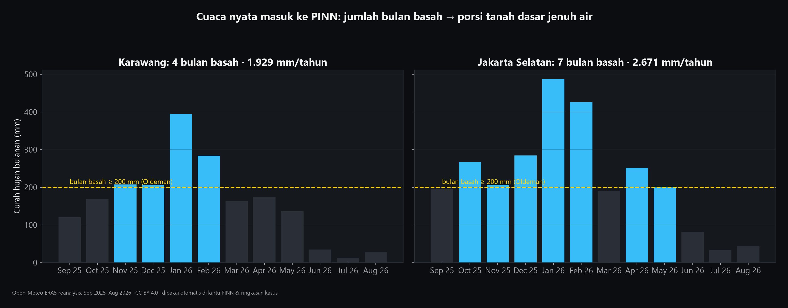

---

## 6. Perangkat Intel: CPU, GPU, NPU

| Perangkat | Status di laptop tim (AMD Ryzen 7 5800HS) | Cara mengukur di perangkat Intel |
|---|---|---|
| CPU | **diukur** (OpenVINO 2026.4, FP32/FP16/INT8) | `python bench/run_all.py` |
| GPU | iGPU AMD dilewati (plugin GPU OpenVINO untuk Intel) | Intel Arc / Iris Xe: `run_all.py` otomatis mengukur `GPU` |
| NPU | tidak ada di laptop tim | Intel Core Ultra: `run_all.py` otomatis mengukur `NPU` (detector INT8, surrogate, SLM INT4) |

Langkah uji NPU (Core Ultra / Intel Tiber Developer Cloud):

```bash
bash bench/remote_setup.sh          # venv + OpenVINO + model
python bench/run_all.py             # semua model x semua perangkat -> measurements/bench_<host>.json
npx tsx scripts/export-measurements.ts   # tampil di /bukti
```

Rencana lengkap: [docs/INTEL_LIFECYCLE.md](docs/INTEL_LIFECYCLE.md) · alasan teknis: [docs/INTEL_RATIONALE.md](docs/INTEL_RATIONALE.md).

---

## 7. Menjalankan aplikasi

### Sehari-hari (Windows, laptop sebagai server)

1. Klik dua kali **`scripts/NYALAKAN-PavementPINN.cmd`**: layanan AI (port 8100), server (port 3100), dan penjaga otomatis yang menghidupkan ulang bila mati.
2. Tunggu ±1 menit, lalu buka **https://avlfelo.tail8b73d2.ts.net** (Tailscale Funnel, HTTPS gratis).
3. Mematikan: **`scripts/MATIKAN-PavementPINN.cmd`**.

Laptop harus menyala dan terhubung internet selama aplikasi dipakai. Untuk server permanen: `scripts/deploy_vm.sh` (VPS mana pun), `docker-compose.yml` + `Caddyfile`.

### Pengembangan

```bash
npm install
cd inference && python -m venv .venv && .venv/Scripts/pip install -r requirements.txt && cd ..
npm run build                     # vite + esbuild -> dist/
npm start                         # server (PORT=3100)
cd inference && .venv/Scripts/python -m uvicorn app.main:app --port 8100   # layanan AI
```

| Perintah | Fungsi |
|---|---|
| `npm run lint` | typecheck TypeScript |
| `npm test` | tes Node (unit + integrasi HTTP) |
| `cd inference && .venv/Scripts/python -m pytest -q` | tes Python (MLET, PINN, CV, konversi foto) |
| `npm run create-coordinator -- email "Nama" "Instansi"` | buat koordinator (`PINN_PASSWORD` di env) |
| `npx tsx scripts/seed-agencies.ts` | akun per instansi pilot |
| `python inference/scripts/build_clip_scenes.py` | bangun ulang kepala scene CLIP |

---

## 8. Pengujian

| Jenis | Cakupan | Hasil terakhir |
|---|---|---|
| Tes Node | state machine workflow, RBAC 18 rute × 4 peran, API HTTP lintas peran, inspeksi multi-sisi (hasil AI palsu dari klien dibuang), ukur di foto, Rute Aman, cuaca, batas modul | **lulus semua** |
| Tes Python | MLET, PINN surrogate, keputusan PINN, CV, konversi HEIC/AVIF/TIFF | **lulus semua** |
| Uji perjalanan pengguna (browser asli) | 2 simulasi lengkap warga → koordinator → petugas → PINN → SPK → perbaikan → selesai | lulus; screenshot & video di `pitchdeck-visuals/` |
| Audit tata letak | 3 peran × HP 390 px & desktop 1440 px, cek tidak ada overflow horizontal | lulus |

Yang perlu diuji atau ditambah berikutnya:
- **NPU / iGPU Intel**: jalankan `bench/run_all.py` di Intel Core Ultra atau Intel Tiber Developer Cloud.
- **Akurasi lapangan**: kumpulkan ≥ 20 foto per kelas di `eval/local_test/` dan jalankan `eval/cv_eval.py` & `eval/clip_eval.py`; akurasi petugas-vs-AI tercatat otomatis di **Statistik**.
- **Uji pengguna (SUS)**: kuesioner SUS sudah ada di aplikasi; targetkan ≥ 20 responden per peran.
- **Uji beban**: server satu proses dengan penyimpanan JSON; untuk skala kota gunakan VPS dan pindahkan penyimpanan ke basis data.

---

## 9. Bahan pitch deck

Semua bahan dibuat ulang dari versi terbaru dengan satu perintah (aplikasi & layanan AI harus menyala):

```bash
PP_KOOR=email:sandi PP_PETUGAS=email:sandi bash .e2e-tmp/pipeline.sh
```

| Folder | Isi |
|---|---|
| `pitchdeck-visuals/slides/1_model_dan_data/` | slide 16:9: dataset, training, evaluasi, kecepatan, OpenVINO, CV, cuaca, arsitektur |
| `pitchdeck-visuals/slides/2_simulasi_A/` | Simulasi 1 langkah demi langkah (lubang, Karawang) |
| `pitchdeck-visuals/slides/3_simulasi_B/` | Simulasi 2 langkah demi langkah (retak & tambalan, Jakarta Timur) |
| `pitchdeck-visuals/videos/` | MP4 H.264: rekaman layar warga & petugas, proses deteksi AI per foto, animasi training PINN |
| `pitchdeck-visuals/screenshots_mentah/` | screenshot asli tanpa bingkai |
| `pitchdeck-visuals/*.png` | grafik mentah (dataset, training, evaluasi, OpenVINO, cuaca) |

Generator: `make_visuals.py` (training ulang + grafik), `make_videos.py` (video), `compose_slides.py` (slide),
`.e2e-tmp/journey.mjs` (simulasi browser). Lihat [pitchdeck-visuals/README.md](pitchdeck-visuals/README.md).

---

## 10. Struktur repo

```
src/            aplikasi React (PWA): pages/, features/, domain/ (aturan bisnis murni), components/
server/         Express: routes/, services/ (cuaca, rute, instansi, CV relay), auth/, repositories/
inference/      FastAPI + OpenVINO: app/cv, app/mlet.py, app/surrogate.py, app/decide.py, app/slm.py, training/
config/         katalog material, harga, quests, instansi
models/         model OpenVINO (IR) dan kartu model
measurements/   hasil ukur (benchmark, PINN, SLM) yang tampil di /bukti
tests/          tes Node (unit, integrasi, arsitektur)
pitchdeck-visuals/  slide, video, grafik untuk pitch deck
docs/           rencana, arsitektur, Intel lifecycle, GenAI disclosure
scripts/        start/stop, deploy, seed akun, ekspor ukuran
```

---

## 11. Privasi, keamanan, dan tata kelola

- EXIF (lokasi kamera, perangkat) dihapus dari setiap foto sebelum disimpan; laporan harus dikirim dari lokasi kerusakan.
- Hasil AI tidak pernah diterima dari klien: server menyalinnya dari penyimpanan analisisnya sendiri, hanya untuk byte foto yang sama.
- Keputusan staf wajib beralasan dan tercatat di audit log; yang mengusulkan penanganan tidak bisa menyetujuinya sendiri.
- Bahasa netral: sistem tidak menuduh pihak mana pun; temuan audit tampil ke publik hanya sebagai "Sedang dalam pemeriksaan teknis".
- Pengungkapan penggunaan GenAI: [docs/GENAI_DISCLOSURE.md](docs/GENAI_DISCLOSURE.md) · sitasi: [docs/CITATIONS.md](docs/CITATIONS.md).
